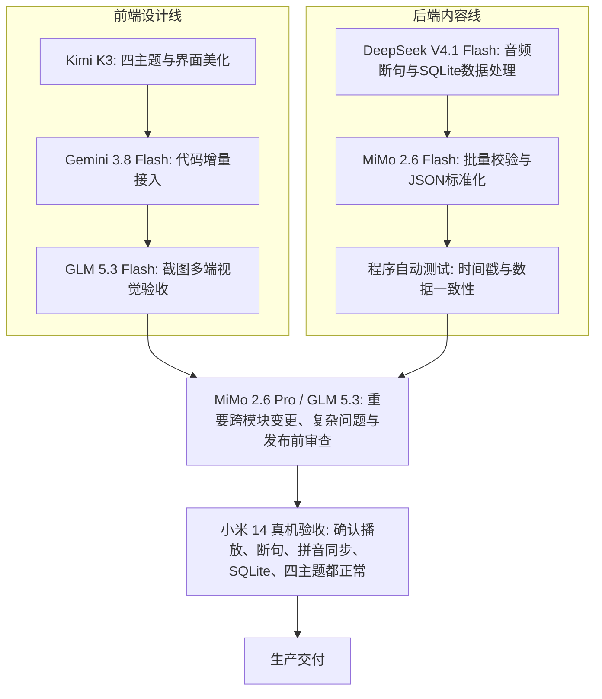

# ListenLoop 多模型团队｜最新版分工方案

> **文件定位**：`English-Content-Factory/00_System/` 核心协作与分工规范  
> **制定日期**：2026-10-10（2026-10-11 增补 ChatGPT 镜像特遣队）  
> **全局真源映射**：`D:\记忆\调度大脑记忆\参考\reference_全维度AI模型智力评分与推荐调度总则.md`  
> **业务工程范围**：Flutter 原生 App ListenLoop、音频断句、SQLite 课文同步、四大主题重构、Obsidian 与 GitHub 协同  
> **核心定调**：**Kimi K3 管视觉，Gemini Flash 管集成，DeepSeek Flash 管数据，MiMo Pro 管复杂问题，GLM 管质量。** 
> **外脑特遣队**：**ChatGPT 镜像 (GPT-6 Chat High 独占席位) 作为顶配外脑特遣队，专攻全项目顶层架构推演与极端疑难问诊！**

---

## 一、 我最推荐的五模型核心团队 ＋ 外脑特遣队

结合项目推进，引入 **ChatGPT 镜像 (GPT-6 High)、MiMo 2.6 Pro、MiMo 2.6 Flash 和 HY4 Preview**，重构分工矩阵：

| 序号 | 模型 | 角色岗位 | 职责边界与工作重点 |
| :---: | :--- | :--- | :--- |
| **00** | **ChatGPT 镜像 (GPT-6 Chat High)** | **外脑顶层架构仲裁 与极端疑难问诊** | 全局顶层推演、跨系统重大方案终审、死锁裁决；Chat 标签 + 顶档 High，单窗口 ≤24 轮，PROLITE 主攻 |
| **01** | **Kimi K3** | **Flutter 前端视觉负责人** | 四主题设计、页面布局、组件美化、动效打磨、截图级高精度还原 |
| **02** | **Gemini 3.8 Flash** | **主工程集成负责人** | 现有代码维护、GitHub 协同、Agent 与 UI 连接、日常主 Builder |
| **03** | **DeepSeek V4.1 Flash** | **内容与数据工程师** | 音频断句检查、SQLite 同步、Python 处理、批量脚本高吞吐执行 |
| **04** | **MiMo 2.6 Pro** | **复杂架构与故障分析** | 疑难 Bug 攻坚、跨模块设计重构、关键 PR 深度技术审查与端内复杂长程任务 |
| **05** | **GLM 5.3 Flash** | **视觉与交付质检** | 截图对比、排版对齐、溢出检查、Flutter 界面视觉回归与像素级验收 |

*官方定位背景支持：Gemini 3.8 Flash 针对多文件工程与长期 Agent 任务优化；MiMo 2.6 Pro 针对复杂长程任务；DeepSeek V4.1 Flash 面向高吞吐、工具化工作流；Kimi K3 适用于长周期编程与多模态任务。实际以各模型在开发环境中的执行权与物理机测试结果为准。*

---

## 二、 完整模型分工：每个模型都有岗位，但不必每天上岗

| 模型 | 最适合负责 | 使用策略 |
| :--- | :--- | :--- |
| **ChatGPT 镜像 (GPT-6 Chat High)** | 外脑顶层架构仲裁、重大方案重构推演、极端死锁攻坚 | **外脑最高特遣队** (Chat标签+顶档High) |
| **Kimi K3** | Flutter 高级视觉设计、组件布局、四主题实现 | **前端主力** |
| **Step 5 Preview** | 创新交互、页面原型、截图驱动设计 | 与 Kimi 进行方案对比 |
| **Gemini 3.8 Flash** | 工程集成、GitHub、Flutter 现有代码维护 | **日常主 Builder** |
| **DeepSeek V4.1 Flash** | Python、SQLite、音频切分脚本、数据校验 | **后端主力** |
| **MiMo 2.6 Pro** | 复杂 Bug、跨模块重构、架构审查 | **重大攻坚任务** |
| **MiMo 2.6 Flash** | 批量结构化内容、JSON 检查、日志整理 | **高频自动化** |
| **GLM 5.3** | 困难代码问题、较大 PR 复审 | 高级代码审查 |
| **GLM 5.3 Flash** | 图片理解、Flutter 截图检查、视觉回归 | **视觉质检** |
| **HY4 Preview** | 大仓库理解、第二意见、复杂方案审查 | 候选审查模型 |
| **Qwen 3.8 Flash** | 中文教研、课文说明、文案、练习内容 | 内容编辑 |
| **GPT-5 全系 (含 5.6/5.5)** | 全系淘汰，GPT 仅考虑 GPT-6 系列 | ⚠️ 已淘汰移出候选 |
| **Work 标签各模型 (含 Astra Max)** | Codex 权限无访问权，发「1+1」或「你好」均被拦截拒绝 | ⛔ 严禁使用 |
| **Space Bunny** | 非关键原型实验 (公开预览已于 10-05 结束，确认实际调用底模) | 暂不进入生产链 |

### 重点新模型定位强调
- **ChatGPT 镜像 (GPT-6 Chat High)**：OpenAI 顶配推理主力，作为外脑最高级特遣队，专攻顶层系统设计与疑难死锁裁决。
- **MiMo 2.6 Pro**：小米官方将其定位为复杂长程工作流旗舰模型，支持多模态理解和超长上下文，承担端内重大架构审查。
- **MiMo 2.6 Flash**：偏高频、低成本的规模化任务；在本项目中专精批量数据检查和标准化输出。
- **GLM 5.3**：官方重点强调复杂编程和长期 Agent 任务，作为 MiMo Pro 代码审查的强力竞争者。
- **HY4 Preview**：腾讯官方将其定位于编程、办公、科研等生产力场景，拥有百万级上下文，承担大仓库宏观方案审查。
- **HY4 Preview**：腾讯官方将其定位于编程、办公、科研等生产力场景，拥有百万级上下文，承担大仓库宏观方案审查。

---

## 三、 两条并行生产线与流转链路

### 生产调度三个实际例子
- **任务 A（美化 ListenLoop 的设置页面）**：让 Kimi K3 负责。输入当前截图、Flutter 页面文件、四主题 Token 规范。输出修改后的 Widget 与截图。然后让 GLM Flash 对比截图，不需要召集所有模型。
- **任务 B（三年级课文导入 SQLite 后，部分音频句子时间戳错误）**：让 DeepSeek Flash 先定位数据处理问题。如果涉及多个异步状态或难以复现的错误，升级给 MiMo Pro。严禁让 Kimi 参与后端修复。
- **任务 C（准备彻底重构整个 Flutter 状态管理架构）**：先交给 MiMo Pro 提出方案，再让 GLM 5.3 独立审查影响范围。经过郭老师批准后，才交给 Gemini 执行，并且必须保留回滚点。

---

## 四、 任务调度选择器（动线契约）

日常派活时按任务类型直接套用标准配置：

| 任务类型 | 业务描述 | 主模型 | 替补模型 | 验收角色 | 执行约束 |
| :--- | :--- | :--- | :--- | :--- | :--- |
| **extbrain** | 外脑架构推演与极端疑难问诊 | **ChatGPT 镜像 (GPT-6 Chat High)** | MiMo 2.6 Pro ｜ GLM 5.3 | 调度大脑终审 ＋ 真实机器探针 | 必须走 Chat 标签 + High 顶档；单窗口 ≤24 轮；三项交付凭证完整回读后方可采纳。 |
| **visual** | Flutter 界面美化与主题设计 | **Kimi K3** | Step 5 Preview | GLM 5.3 Flash | 只修改 Flutter 表现层。保留 AudioEngine、SQLite 和课文同步逻辑。 |
| **code** | Flutter 代码修改与功能集成 | **Gemini 3.8 Flash** | GLM 5.3 | MiMo 2.6 Pro | 基于现有仓库增量修改，必须运行 flutter analyze 和相关测试。 |
| **data** | 音频切分、SQLite 与数据工程 | **DeepSeek V4.1 Flash** | MiMo 2.6 Flash | 确定性程序测试 | 验证时间戳、SQLite 读写和数据一致性，禁止伪造测试结果。 |
| **architect** | 重大架构决策与复杂故障 | **MiMo 2.6 Pro** | GLM 5.3 | HY4 Preview | 分析项目影响范围和替代方案，未批准前不得大规模修改代码。 |
| **content** | 课文内容、拼音与教研加工 | **Qwen 3.8 Flash** | MiMo 2.6 Flash | 人工教研复核 | 整理课文学习内容，保证内容有来源，不改变数据结构。 |
| **automation** | GitHub、Obsidian 与 Skill 自动化 | **Gemini 3.8 Flash** | MiMo 2.6 Flash | DeepSeek V4.1 Flash | 维护可重复执行的 Skill、日志和 GitHub 流程，并提供自动测试。 |

---

## 五、 四条铁律（比选择哪个模型更重要）

1. **规则一：同一文件只允许一个主执行 Agent 修改。**  
   Kimi 负责 Flutter 表现层，DeepSeek 负责后端脚本，双方采用独立 Git 分支。`main.dart`、公共状态管理和依赖配置等共享文件由主集成协同。
2. **规则二：大模型审查意见不等于测试通过。**  
   真正的验收必须包含 `flutter analyze`、`flutter test`、SQLite 与音频回归，以及**小米 14 物理真机**的实际操作测试。
3. **规则三：高级模型只处理值得它处理的问题。**  
   MiMo Pro、GLM 5.3 适合复杂问题、重要审查。普通内容提取和批量格式转换优先用 Flash 模型，降低成本。
4. **规则四：每次任务只向你展示一个核心成果。**  
   AI 之间传递代码、变更清单和测试报告；呈报给郭老师的应当是新版界面截图、前后差异和一个明确的批准选项，而不是每个 Agent 各写几千字报告。

---

## 六、 最终选择与执行组合

推进 **ListenLoop 的四主题 Flutter 重构，同时进行三年级课文与 SQLite 同步** 时的启动阵容：
- **前端视觉**：Kimi K3
- **后端数据**：DeepSeek V4.1 Flash
- **主程集成**：Gemini 3.8 Flash
- **视觉质检**：GLM 5.3 Flash
- **疑难攻坚**：MiMo 2.6 Pro（按需介入）
