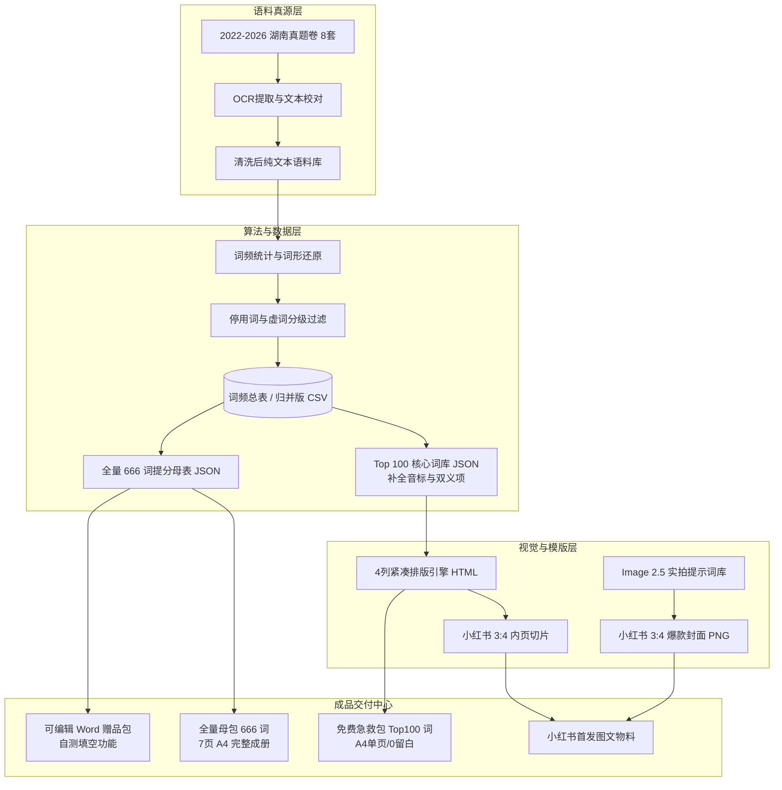

# PROJECT_MAP.md - 英语内容工厂全景拓扑图



## 目录模块索引

- `01_项目_湖南中考英语666词/`
  - `00_项目主控与看板/`：Obsidian 双链总入口与迁移记录
  - `01_战略方案与SOP/`：4 篇 GPT 方案、万字 SOP 与商业决策
  - `02_真题语料与校对/`：真题纯文本与 OCR 校对文本
  - `03_核心词频数据库/`：结构化 JSON 与 CSV 数据资产
  - `04_设计工坊与资产/`：Image 2.5 封面库与排版样式模版
  - `05_成品交付中心/`：各版本最终可交付物料
  - `06_自动化工具箱/`：清洗、统计、渲染 Python 工具集
  - `07_架构决策记录/`：历次架构与版式 ADR

---

## 项目登记（现行 `02_Projects/`）

> 上表为迁移前的中文目录快照，仅作历史参考。**现行项目一律登记于 `02_Projects/`。**

| project_id | 名称 | 状态 | 语料范围 | 主要交付物 |
| :--- | :--- | :--- | :--- | :--- |
| `HN-ENGLISH-666` | 湖南中考英语 666 词 | `content_ready` | 湖南中考真题 2022—2026（8 套） | 词频数据集、666 词母表、刷词本、小红书物料 |
| `CN-ENGLISH-MULTI` | 多地中考英语词汇（多地区） | `analyzing` | 6 地区 29 套（含省统考口径 19 套） | 词汇筛选统计表、省统考口径数据 |
| `HN-ZK-ZHUANXIANG` | 湖南中考英语 · 题型专项 | `rendered` | 湖南中考真题 2021—2026（9 套） | 11 册分题型专项可打印 HTML（85 篇） |

### 依赖关系

```
HN-ENGLISH-666 ──(共用 2022—2026 语料)──▶ HN-ZK-ZHUANXIANG
HN-ENGLISH-666 ──(共用 2022—2026 语料)──▶ CN-ENGLISH-MULTI
```
